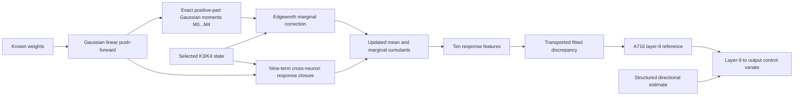

# Reconstructing Puffi's A716 analytical reference for phase two

Research date: 5 September 2026.

This note explains the useful part of Puffi's phase-one disclosure, the parts the disclosure does not specify, our explicit reconstruction choices, and the first phase-two measurements. The implementation is a **Puffi-inspired reconstruction**, not recovered Puffi code and not a reproduction of submission #327950.

The main result is narrow but useful: the reconstructed rich state is an excellent shallow analytical reference. On eight untouched public Mini networks, its post-ReLU layer-9 MSE was `2.90282e-7`, versus `2.62532e-6` for the ordinary full-covariance closure. That is an 88.94% reduction at the control layer. Used alone as a 16-layer estimator, it achieved `4.35718e-7` compute-adjusted final error, only 0.79% better than covariance. Puffi's larger gain came from using the shallow reference to correct a structured directional estimator at the output; that second half remains to be built.

## The idea in plain language

A Gaussian moment closure remembers a neuron's mean and the pairwise covariance between neurons. After several ReLU layers the activation distribution is not Gaussian: it becomes skewed, heavy-tailed, and dependent in ways that covariance alone cannot express.

A716 retains a carefully chosen slice of that missing information:

- the full covariance matrix;
- each neuron's third and fourth cumulant;
- a paired fourth-order matrix for terms shaped like `(i,i,j,j)`;
- the latest eight generations of mixed third-order terms shaped like `(i,i,j)`;
- a small learned response correction, transported through later weights and local ReLU gains.

It avoids the impossible full third- and fourth-order tensors. At width 1024 those would contain roughly 1.07 billion and 1.10 trillion entries. A716 keeps vectors, matrices, and structured rank terms instead.



The last two boxes are easy to confuse. A716 is the analytical center at layer 9. Puffi's final estimator compared that center with a deterministic Kerdock/Walsh sample mean, then transported the discrepancy to the final layer with a within-network ridge response. The analytical reference was not intended to do the whole 32-layer job by itself.

## The published equations

For a layer with weight matrix `W`, the carried mean `m` and covariance `C` first undergo the linear push-forward

$$
m_z = W^T m, \qquad \Lambda = W^T C W,
$$

with marginal variance `v = diag(Λ)`, standard deviation `σ`, and standardized mean `r = m_z / σ`.

For a Gaussian variable, the positive-part raw moments are exact:

$$
M_0=\Phi(r), \qquad M_1=m_z M_0+\sigma\phi(r),
$$

$$
M_k=m_zM_{k-1}+(k-1)vM_{k-2}, \qquad k=2,3,4.
$$

Puffi differentiates these moments with respect to the preactivation mean. The mean-channel derivatives are

$$
F_{1,1}=\Phi(r),\quad F_{1,2}=\phi(r)/\sigma,\quad
F_{1,3}=-r\phi(r)/v,\quad
F_{1,4}=(r^2-1)\phi(r)/(v\sigma).
$$

If `d3` and `d4` are the transported marginal third and fourth cumulants, each moment receives a truncated Edgeworth correction:

$$
\Delta M_k = \operatorname{clip}_{0.25\sigma^k}
\left(\frac{F_{k,3}d_3}{6}+\frac{F_{k,4}d_4}{24}\right).
$$

The corrected first four raw moments are converted back to mean, variance, skew cumulant, and fourth cumulant. The 25% clip is an empirical stability device.

The cross-neuron update is the distinctive part. Puffi constructs nine `n x n` kernels from covariance `Λ`, the mixed third-order state `P`, paired fourth-order surrogate `D4`, marginal third cumulant `d3`, and propagation scale `αp = 0.8`. Each kernel is multiplied on the left and right by the appropriate response derivatives. Schematically,

$$
C_{\text{off}}^{(L)}=\sum_{s=1}^{9}
\operatorname{diag}(F_{1,a_s})Q_s\operatorname{diag}(F_{1,b_s}),
$$

where `(a,b)` are the derivative-order pairs published in equations A25-A26. The marginal variance replaces the diagonal afterward.

Finally A716 builds ten response features `h1...h10`. They include the total mean correction, separate third- and fourth-cumulant corrections, `σφ(r)`, a normalized paired-fourth feature, and Hermite-polynomial interactions of standardized third and fourth cumulants. A layer-specific coefficient vector `β(L)` creates a discrepancy correction:

$$
s^{(L)}=\Phi(r^{(L)})\odot[(W^{(L)})^Ts^{(L-1)}]
  +H^{(L)}\beta^{(L)},
$$

$$
\mu_A^{(L)}=m_b^{(L)}-s^{(L)}.
$$

Puffi fitted 90 coefficients jointly for nine layers. They then used the layer-9 discrepancy between the structured sample mean and `μA` as a control variate for the output. The disclosed output shrinkage was `ρ = 0.75`.

## What is reproducible and what is missing

The appendix publishes the state description, Gaussian moment table, marginal Edgeworth correction, nine response kernels, feature definitions, eight-generation history, propagation scale, and correction recurrence. It does **not** publish everything needed to recreate A716 exactly.

| Component | Disclosure status | Our implementation |
|---|---|---|
| Gaussian push-forward and moments | Fully specified | Direct implementation of A19-A22 |
| Marginal K3/K4 correction and clipping | Fully specified | Direct implementation of A23-A24 |
| Nine covariance response contractions | Fully specified | Direct implementation of A25-A26 |
| Mixed `(2,1)` history length and scale | Length and scale specified; exact update omitted | Eight generations of symmetric rank terms; inject the residual required to match current repeated-index slices |
| Paired `(2,2)` fourth state | Diagonal contraction and row-mean idea described; exact formula omitted | Exact contraction of the retained paired tensor on the diagonal; symmetric row-mean surrogate off diagonal |
| Ten response features | Mostly specified | Channels implemented; channel 3 disabled because `g4,L` is unpublished; channel 5 is published as zero |
| 90 fitted coefficients | Values omitted | New ridge fit performed on a disjoint phase-two development shard |
| Kerdock sample bank and layer-9/output response | Algorithm specified in later sections | Not part of this first-step reference implementation |

These gaps matter. Calling this code “A716” without qualification would overstate what the public appendix permits. The source file labels the reconstruction at the module boundary and beside each completion choice.

## Our phase-two experiment

The protocol was written before examining the validation shard:

- development: all eight networks in public Mini shard 0, IDs 0-7;
- validation: all eight networks in public Mini shard 1, IDs 8-15, loaded only after ridge selection and coefficient freezing;
- phase-two shape: width 1024, depth 16, FLOP budget `2^41`;
- rich reference through layer 9, then ordinary gain closure to return the required 16 rows;
- eight-generation third-order history and propagation scale 0.8;
- four candidate ridge strengths selected by leave-one-network-out development error;
- unpublished feature 3 and published-zero feature 5 fixed at zero.

The fitted design has 72 active columns: eight usable features at each of nine layers. Its target is the layer-9 per-neuron residual. This recreates the disclosed form with newly learned coefficients; it does not recover Puffi's coefficients.

| Method | Development layer-9 raw MSE | Validation layer-9 raw MSE |
|---|---:|---:|
| Gain-covariance closure | 2.69413e-6 | 2.62532e-6 |
| Reconstructed rich state, no fitted correction | 3.12855e-7 | 2.90282e-7 |
| New 72-parameter ridge correction | **3.09683e-7** | **2.89901e-7** |

The rich state generalizes strongly at the layer it was designed to model. The learned correction adds little: 1.01% on development and 0.13% on validation at layer 9.

| Method | Development final raw MSE | Validation final raw MSE | Validation utilization | Validation adjusted MSE |
|---|---:|---:|---:|---:|
| Gain-covariance closure | 4.39423e-6 | 4.39208e-6 | 2.351% | 4.39208e-7 |
| Unfitted rich reference | 1.75626e-6 | **1.73746e-6** | 25.078% | **4.35718e-7** |
| Newly fitted correction | 1.76900e-6 | 1.75397e-6 | 25.078% | 4.39857e-7 |

The fitted correction is rejected: it slightly worsens final validation error and adjusted score. The unfitted reconstruction is retained as the honest analytical reference. Its final adjusted gain over covariance is only 0.79%, because the competition charges its much larger compute utilization.

## Why the rich state stops at layer 9

Phase two is deeper than Puffi's disclosed reference. Extending the rich closure farther does reduce raw error, but every extra rich layer adds roughly 103.3 billion FLOPs and more Python/flopscope overhead.

On the eight-network validation shard:

| Rich layers | Final raw MSE | Utilization | Adjusted MSE | Mean residual time |
|---:|---:|---:|---:|---:|
| 9 | 1.73746e-6 | 25.078% | **4.35718e-7** | 0.223 s in the preregistered run |
| 10 | 1.58174e-6 | 29.775% | 4.70964e-7 | 0.346 s |
| 11 | 1.41864e-6 | 34.472% | 4.89037e-7 | 0.392 s |

Eleven layers came within 0.2 milliseconds of the 0.4-second residual cap on one local network. Ten and eleven layers both lose on compute-adjusted score despite their lower raw error. A two-network 16-layer scout reached `7.22319e-7` raw MSE, but used 57.96% of the FLOP budget and about 0.57 seconds residual time, violating both phase-two caps. Nine rich layers is the supported cutoff.

## What the result means

This experiment validates Puffi's central architectural judgment: high-order analytical propagation is most valuable as a shallow reference for a correlated numerical estimator. It does not validate the reference as a standalone winner. The leading phase-two scores recorded in the reconnaissance are around `3.8e-9`, roughly two orders of magnitude below this candidate, on a different leaderboard cohort.

The next implementation should preserve the nine-layer rich reference and add the missing correlated branch:

1. propagate a budgeted structured directional design to layer 9 and the output;
2. compute the layer-9 discrepancy between its sample mean and this reference;
3. fit a within-network ridge response from centered layer-9 directional activations to centered output activations;
4. transport a shrunk discrepancy to the output, reproducing equations A31-A38;
5. compare that candidate with both the current public blend and the unfitted reference on new held-out shards.

The reference gives that control variate a substantially better center than covariance. That is the reason to keep it even though its standalone adjusted score barely moves.

## Files and rerun commands

- `puffi_reference.py`: standalone inference implementation.
- `test_puffi_reference.py`: derivative and structured-third-source checks.
- `puffi_protocol.json`: preregistered split and fitting choices.
- `fit_puffi_reference.py`: disjoint development/validation fitting harness.
- `results/puffi_reference_fit.json`: coefficients, cross-validation errors, per-network results, and code hash.
- `benchmark_puffi_depth.py`: phase-two rich-depth/resource ablation.

From the starter-kit directory:

```powershell
$env:PYTHONIOENCODING='utf-8'
& ./.venv-phase2/Scripts/python.exe -m pytest research/phase2/test_puffi_reference.py -q
& ./.venv-phase2/Scripts/python.exe research/phase2/fit_puffi_reference.py `
  --development ../tmp/phase2_mini_first8.arrow `
  --validation ../tmp/phase2_mini_validation8.arrow `
  --output research/phase2/results/puffi_reference_fit.json
& ./.venv-phase2/Scripts/whest.exe validate `
  --estimator research/phase2/puffi_reference.py --format plain
```

## Primary reading

- [Puffi's phase-one forum write-up](https://discourse.aicrowd.com/t/phase-1-write-ups-team-puffi/18175) gives the overview and links the archive.
- [Puffi's technical appendix](https://discourse.aicrowd.com/uploads/short-url/iDdUNo66HzI7ovRqhQqpLOFFugI.pdf) is the main source. Read sections A.7 and A.8 first; equations A19-A28 define A716 and A29-A38 define the inter-layer correction.
- [The official phase-two launch announcement](https://discourse.aicrowd.com/t/phase-2-of-the-arc-white-box-estimation-challenge-is-live/18197) defines the dimensions and resource caps used here.
